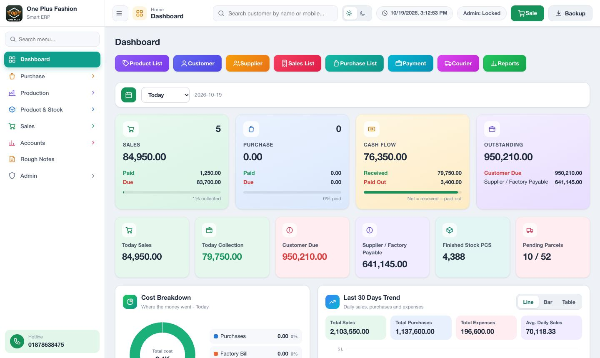
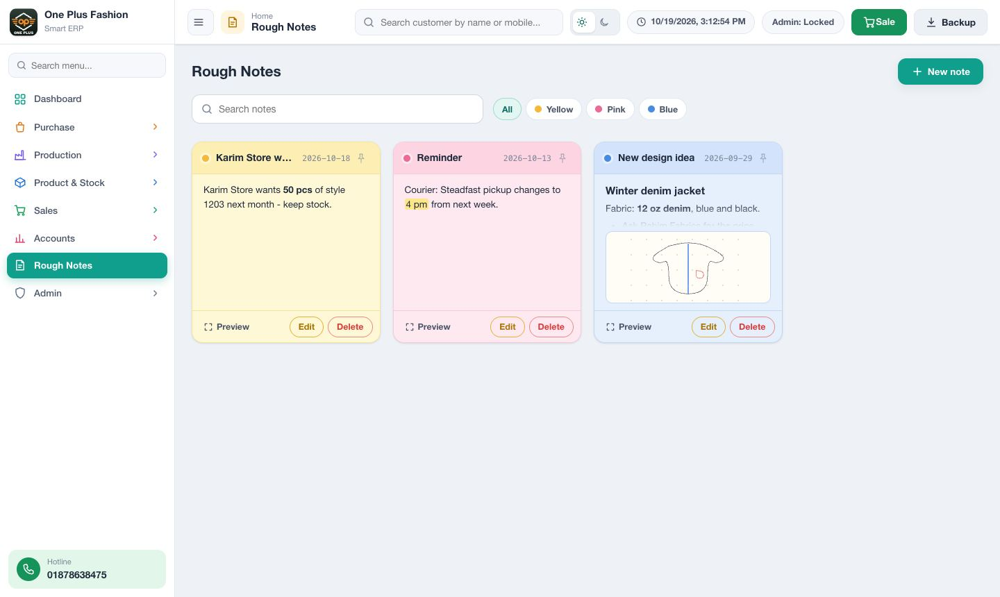

<div align="center">

# 👕 One Plus Fashion — Smart ERP v4

**A complete, offline ERP for a wholesale garment business**<br>
Purchase · Production · Stock · Sales & Invoices · Customer Dues · Payments · Courier · Costing · Reports

[](https://enamulhaque028.github.io/oneplus_fashion_erp/)
[](https://github.com/enamulhaque028/oneplus_fashion_erp/archive/refs/heads/main.zip)


-475569)


</div>



---

## ✨ What it does

| Area | Pages |
|---|---|
| 🛒 **Purchase** | Suppliers · Fabric / Raw Purchase · Raw Material Stock |
| 🏭 **Production** | Production Order · Material Issue · Production / Finished · Factory / Worker |
| 📦 **Product & Stock** | Style / Product · Factory → Shop transfer · Showroom Stock · Costing & Stock Summary |
| 💰 **Sales** | Customers · Sales / Invoice · Sales Return · Payment / Collection · Courier / Delivery |
| 📊 **Accounts** | Expenses · Ledgers / Due · Reports (P/L view) |
| 📝 **Rough Notes** | Notes with formatting, links, colours, pins and quick sketches |
| 🛡️ **Admin** | Users / Activity log · Settings / Backup · admin password |

**Highlights**

- 🧾 **Cash memo and money receipt** printed in the shop's own memo-book layout, with amounts in words (crore / lakh).
- 📒 **One ledger for every due.** Customer, supplier and factory balances always agree on every screen, print and export.
- 🔎 **Search** a customer by name or mobile number and open their full history and statement.
- 📤 **Excel backup** (`.xlsx`, every register and ledger) and a **restore file** (`.json`).
- 🌗 **Light and dark theme**, a grouped sidebar, dashboard charts, and page addresses that work with Back, bookmarks and new tabs.
- 🔒 **Admin password** for editing, deleting and settings.

**Workflow**

```
Supplier → Purchase → Raw Stock → Material Issue → Production → Finished Goods
        → Factory → Shop Transfer → Showroom Stock → Sale / Invoice → Customer Due
        → Payment / Receipt → Courier → Reports
```

---

## 🚀 Two ways to use it

### Option 1: online (any computer with internet)

Open **https://enamulhaque028.github.io/oneplus_fashion_erp/** in Chrome or Firefox. Nothing to install.

> [!NOTE]
> The data is saved in **that browser on that computer**. The online link and the double-click version (option 2) keep separate data.

### Option 2: on the shop computer, offline (recommended for Windows 7)

1. **Download** the ZIP: [**oneplus_fashion_erp-main.zip**](https://github.com/enamulhaque028/oneplus_fashion_erp/archive/refs/heads/main.zip)
   (or on GitHub: green **Code** button → **Download ZIP**).
2. **Extract** it to a fixed place, for example `D:\OnePlusFashion_ERP\`.
3. **Double-click `START_ERP.bat`.** It opens the ERP in Chrome, or in Firefox if Chrome isn't installed.
4. *Optional:* right-click `START_ERP.bat` → **Send to → Desktop (create shortcut)**.

No Python, database, Node.js or server is needed. It works with no internet at all.

> [!IMPORTANT]
> - **Keep the folder together:** `OnePlusFashion_ERP.html`, `START_ERP.bat`, `assets\` and `js\`.
> - **Keep the folder in the same place, and don't rename `OnePlusFashion_ERP.html`.** Firefox keeps the saved data per file.
> - **Don't clear the browser's "cookies and site data"**: that is where the ERP data lives. Take a backup first if you must.

### Try it with demo data

**Settings / Backup → Restore from .json** → choose `tests/fixtures/OnePlusFashion_Demo_Data.json`.
It loads about 4 months of sample suppliers, production, invoices, payments, courier parcels and notes.
Use it on a test computer or the online link, because it **replaces** the data already there.

---

## 💾 Backups and updates

| Task | How |
|---|---|
| **Daily backup** | **Settings / Backup → Download Restore File (.json)**. This is the file that can load everything back. Keep copies on another drive or a pen drive. |
| **Excel copy** | The header **download** button (next to EN \| বাং), or **Settings / Backup → Download Full Backup (Excel .xlsx)**, gives every register and ledger in one workbook for reading or printing. |
| **Move to another computer** | Download the `.json` restore file, then open the ERP on the new computer and use **Restore from .json**. |
| **Update to a new version** | 1. Download a `.json` backup. 2. Download the new ZIP. 3. Extract it **over the same folder** (replace the files). 4. Open with `START_ERP.bat`. The data stays, and older data is upgraded automatically. |

> [!CAUTION]
> The admin password can't be recovered if it's forgotten. Write it down somewhere safe.

---

## ☁️ Google Drive backup (optional, currently switched off)

The ERP can sign in with Google and keep its data in the shop's own Google Drive, so every computer has the same data. A daily copy is kept for 30 days.

It is **switched off** right now. To turn it on, set the flag in [`js/core/config.js`](js/core/config.js) and push:

```js
CLOUD: {
  ENABLE_GOOGLE_LOGIN: true,   // false = switched off (no sign-in screen, data stays on the computer)
```

It works on the online link only. Setup and troubleshooting: [docs/CLOUD_SETUP.md](docs/CLOUD_SETUP.md) ·
[Privacy Policy](https://enamulhaque028.github.io/oneplus_fashion_erp/privacy.html) ·
[Terms](https://enamulhaque028.github.io/oneplus_fashion_erp/terms.html)

---

## 📝 Rough Notes



A notepad for ideas and reminders:
- **bold, italic and underline**, headings, lists, highlight, text colours and links (`Ctrl+K`);
- one **sketch** per note (pen, eraser, undo);
- note **colours**, **pins**, live search and a full preview.

---

## 📚 Documentation

| Document | For |
|---|---|
| [docs/USER_GUIDE.md](docs/USER_GUIDE.md) | Shop staff and owner: every page, printing, backups, formulas, troubleshooting |
| [docs/QA_CHECKLIST.md](docs/QA_CHECKLIST.md) | A 30-minute check on the shop laptop before going live |
| [docs/CLOUD_SETUP.md](docs/CLOUD_SETUP.md) | Google sign-in and Drive backup setup, and the on/off flag |
| [docs/ARCHITECTURE.md](docs/ARCHITECTURE.md) | Developers: structure, layers, how to add a page |
| [AGENTS.md](AGENTS.md) | Rules and status for developers and AI coding agents |

**Before going live:** double-click `tests/browser-smoke.html`. It must say **"PASS - this browser runs the ERP correctly"**. It uses temporary data and never touches the ERP data. Then follow [docs/QA_CHECKLIST.md](docs/QA_CHECKLIST.md).

---

## 🧑‍💻 For developers

Plain HTML, CSS and JavaScript (ES2019) in `<script>` files. There's no build step, no framework and no dependencies, so it runs from `file://` on Chrome 73+.

```
OnePlusFashion_ERP.html   the app (index.html forwards to it on the hosted site)
START_ERP.bat             opens the app on Windows
assets/css/               app.css (light + dark tokens), print.css (cash memo)
js/core/                  config, store (localStorage), migrations, utilities
js/domain/                business rules: ledger, stock, calculations (no DOM)
js/ui/                    router, forms, records, icons, charts, rich text, sketch
js/services/              print, Excel writer, backup, Google Drive sync
js/pages/                 one file per page
tests/                    puppeteer suites, self-test page, demo data
```

```bash
cd tests && npm install        # once (puppeteer-core only)
npm test                       # e2e, edge, uat, regression, cloud and the self-test on installed Chrome
node fixtures/make-demo-data.js   # rebuild the demo data
```

Rules (offline-first, ES2019, script order, migrations, one ledger) are in **[AGENTS.md](AGENTS.md)**.
Data is one JSON document in `localStorage` (`opf_erp_smart_v3`). Changes to its shape need a migration.

---

## 📌 Status

- ✅ v4 is complete: all client issues are done, plus the cash memo, redesigned UI, page navigation, Excel backup, Rough Notes and Google Drive sync (switched off).
- ✅ Automated tests pass on current Chrome, Chromium 109 and Chrome 73, and the self-test passes on Firefox 115.
- ⏳ **To do on the real shop laptop:** the manual [QA checklist](docs/QA_CHECKLIST.md) (printer, Microsoft Excel, owner's sign-off on the business rules).
- 🚫 **Not in this offline edition:** multi-user logins and roles, barcode scanning, multi-branch. Those need a server version.

<div align="center"><sub>One Plus Fashion · Smart ERP v4 · Hotline 01878638475</sub></div>
